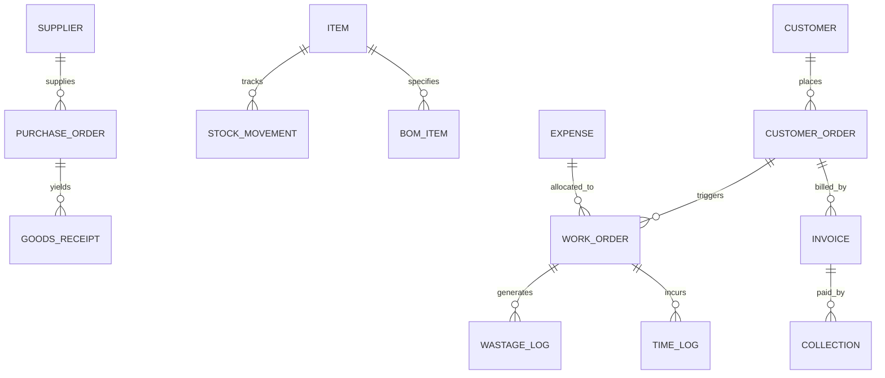

# Dot Advert ERP — Frontend Interactive Mockup Implementation Plan

An enterprise-grade, fully interactive, frontend-only mockup for **Dot Advert ERP** built using **Next.js (App Router)** and **TypeScript**, backed entirely by realistic pre-seeded mock data and reactive `localStorage` persistence.

---

## 1. Architectural Strategy & Technical Stack

### Core Technology Choices
- **Framework**: [Next.js](https://nextjs.org/) (App Router, React 19 / Client Components for rich interactive state).
- **Language**: TypeScript (strict typings for all ERP entities, calculations, and financial ledgers).
- **Design & Styling**: Pure modern CSS / CSS Modules with custom design tokens (sleek dark/light enterprise aesthetic, glassmorphism cards, responsive layouts, data grids, and status badges).
- **Icons**: Lucide React.
- **Charts / Visualizations**: Lightweight Canvas/SVG charts or Chart.js/Recharts for order profitability waterfalls, revenue trends, and inventory distribution.
- **State & Storage**: Browser `localStorage` abstraction layer with auto-hydration, initial seed data, and a one-click **"Reset Mock Data"** demo toggle.
- **Zero Backend**: All business logic (VAT calculation, stock movements, credit limit validation, labor costing, order profit margins) runs client-side.

---

## 2. Mock Data Architecture & `localStorage` Schema

The ERP will store all data in localized collections under a namespace key (`dot_advert_erp_v1_*`).

### Data Entities & Schema Map



1. **Items & Stores**:
   - `items`: Code, Name, Amharic Name, Type (`raw`, `packaging`, `finished`, `semi-finished`), Unit, Purchase Price, Selling Price, VAT Type (`standard 15%`, `exempt`, `zero-rated`), Min Reorder Level, Safety Stock.
   - `stores`: Main Store, Raw Materials Warehouse, Finished Goods Store, Production Floor.
   - `stock_movements`: Immutable log of receipts, production issues, transfers, returns, adjustments, and wastage.

2. **Procurement**:
   - `suppliers`: Name, TIN, Payment Terms, Bank Details, Category, VAT Registered status.
   - `purchase_orders`: PO Number, Supplier, Items, Unit Prices, Tax, Status (`draft`, `approved`, `received`, `cancelled`).
   - `goods_receipts`: Inspection report, Batch/Lot #, Accepted/Rejected Qty, Store destination.

3. **Production & Orders (The Centerpiece)**:
   - `customer_orders`: Client, Description (e.g. *Awash Bank Pylon Signs*), Agreed Price, Due Date, Status.
   - `work_orders`: BOM Version, Planned vs Actual Qty, Scrap Qty, Machine Hours logged, Status.
   - `order_costs`: Direct Materials + Direct Labor + Machine Rate + Order-specific Transport + Allocated Fixed Overhead + Wastage = **Total Order Cost**.
   - `order_profitability`: Net Revenue (excluding VAT) − Total Order Cost = **Net Order Profit** & **Margin %**.

4. **Sales & Billing**:
   - `customers`: Name, TIN, Credit Limit, Payment Terms, Available Credit balance.
   - `invoices`: Dual mode:
     - **VAT Invoice**: Subtotal + 15% VAT + Total, QR code mock, TIN numbers.
     - **Non-VAT / Exempt Invoice**: Reason specified (exempt product / non-VAT customer).
   - `collections`: Payment records with method (`Telebirr`, `Chapa`, `Cash`, `CBE Bank Transfer`, `Cheque`), transaction ref, and customer credit ledger update.

5. **Payroll & Cost Allocation**:
   - `employees`: Name, Role, Hourly/Monthly Base, Overtime rate, Cost Center (`Direct Production`, `Factory Overhead`, `Admin`).
   - `payroll_runs`: Base + Overtime + Allowances − Income Tax − Pension (11% employer, 7% employee) = Net Pay. Direct hours allocate cost to specific work orders.

6. **Expenses**:
   - `expenses`: Category (`Rent`, `Electricity`, `Fuel`, `Machine Maintenance`, `Delivery Transport`), Type (`Fixed`, `Variable`, `Semi-Variable`), Allocation rule (Direct Order ID or General Period Expense).

---

## 3. Implementation Phases

```
┌─────────────────────────────────────────────────────────────────────────────┐
│ PHASE 1: Scaffolding, Design System & LocalStorage Seed Engine             │
├─────────────────────────────────────────────────────────────────────────────┤
│ PHASE 2: Store, Inventory & Procurement Modules (Movements & Wastage)      │
├─────────────────────────────────────────────────────────────────────────────┤
│ PHASE 3: The Order Engine & Cost Breakdown (Direct, Labor, Machine, Scrap) │
├─────────────────────────────────────────────────────────────────────────────┤
│ PHASE 4: Commercial Suite: Sales, Dual Invoicing (15% VAT/Exempt) & Pay    │
├─────────────────────────────────────────────────────────────────────────────┤
│ PHASE 5: Payroll, Overhead Expenses & Cost Allocation Engine                │
├─────────────────────────────────────────────────────────────────────────────┤
│ PHASE 6: Executive Finance Dashboard, Reports & "The Golden Demo" Story     │
└─────────────────────────────────────────────────────────────────────────────┘
```

### Phase 1: Scaffolding, Design System & Mock Storage Engine
- Set up Next.js application with TypeScript and modern CSS variables.
- Build the **Global Navigation & Layout**: Collapsible sidebar, top bar with breadcrumbs, quick notification tray, and a persistent **"Demo Data: [Reset / Seed Realistic Data]"** toolbar.
- Build the **Local Storage Database Provider**: React Context that initialises pre-populated, realistic Ethiopian business demo data (e.g., *Ethio Telecom Expo Booth*, *Awash Bank Acrylic Signage*, *BGI Billboard Skins*).
- Build shared UI components: Metric stat cards, searchable data tables, filter pills, modal drawers, status badges, and currency formatters (`ETB`).

### Phase 2: Inventory, Stores & Procurement
- **Store & Inventory Dashboard**:
  - Item catalog with low-stock badges.
  - Multi-warehouse inventory matrix (Main Warehouse, Production Floor, Raw Materials).
  - Dynamic Low-Stock Alert widget calculating:
    $$\text{Days Remaining} = \frac{\text{Current Stock}}{\text{Average Daily Usage}}$$
- **Stock Movement Ledger**:
  - Interactive modal to record goods receipt, transfer, or issue with instant inventory update.
- **Wastage Management Center**:
  - Log wastage with reason dropdown (*Damaged, Expired, Production Scrap, Theft, Measurement Error*), cost calculation, and order tagging.
- **Procurement Flow**:
  - Purchase Request $\rightarrow$ Purchase Order $\rightarrow$ Goods Receipt $\rightarrow$ Supplier Bill.

### Phase 3: The Order Engine & Order Profitability (Core Value)
- **Order Management & Job Cards**:
  - Customer order list with progress badges (*Queued, In Production, QA, Completed, Delivered*).
  - Order Detail View with real-time financial summary:
    - Net Invoiced Amount (excluding VAT).
    - Material Costs (from inventory issue log).
    - Direct Labor Costs (from operator hours logged).
    - Machine Hours Cost ($\text{Hours} \times \text{Machine Hourly Rate}$).
    - Wastage Cost incurred for this job.
    - Allocated Overhead.
    - **Gross Profit & Net Margin (%)** with visual color-coded indicator (Green: $> 35\%$, Amber: $15\text{--}35\%$, Red: $< 15\%$).
- **Interactive Work Order & BOM Simulator**:
  - Allow users to click "Issue Materials to Order" or "Log Scrap" and watch the order cost and profit dynamically recalculate.

### Phase 4: Sales, Dual Invoicing & Collections
- **Sales Orders & Customer Credit Protection**:
  - Customer list showing credit limit, outstanding invoices, and available credit:
    $$\text{Available Credit} = \text{Credit Limit} - \text{Outstanding Balance}$$
  - Warning/block trigger when creating an order for an over-limit customer.
- **Dual Invoicing Engine**:
  - Toggle between **15% VAT Invoice** (calculating Subtotal, 15% VAT, and Grand Total) and **Non-VAT / Exempt Invoice** with statutory exemption reason.
  - Printable / PDF-style modal preview with Ethiopian tax formatting, TIN numbers, and payment details.
- **Cash & Digital Collections Modal**:
  - Collect payments linked to invoices via **Telebirr**, **Chapa**, **Bank Transfer (CBE / Awash)**, or **Cash**.
  - Auto-updates invoice status (*Paid, Partially Paid, Overdue*) and customer credit availability.

### Phase 5: Payroll & Expense Cost Allocation
- **Payroll Manager**:
  - Employee list with wage configuration.
  - Monthly payroll generator with attendance, overtime, 11% employer pension, 7% employee pension, and income tax brackets.
  - Labor allocation tab: Assign hours to work orders (Direct Labor) vs general admin.
- **Expense Ledger**:
  - Categorized into Fixed (rent, security), Variable (order delivery fuel, extra materials), and Semi-variable.
  - Order-linking selector: Directly attach expenses to specific customer jobs.

### Phase 6: Financial Reports & "The Golden Demo" Walkthrough
- **Executive Finance Dashboard**:
  - Total Net Revenue, COGS, Gross Profit, Operating Expenses, Net Income.
  - VAT Statement: Output VAT collected vs Input VAT paid = Net VAT Payable.
  - AP / AR Aging charts (Current, 30 days, 60 days, 90+ days).
- **The "Golden Demo Story" Guided Tour**:
  - A built-in interactive scenario walkthrough banner that guides the evaluator step-by-step through the end-to-end journey:
    1. *Step 1*: Check Raw Material in Store.
    2. *Step 2*: Open Customer Work Order (e.g. *Awash Bank Signboard*).
    3. *Step 3*: Issue 20m Vinyl + Log 2m Waste.
    4. *Step 4*: Complete Production & Mark Delivered.
    5. *Step 5*: Generate 15% VAT Invoice.
    6. *Step 6*: Collect payment via Telebirr.
    7. *Step 7*: Inspect final Order Profitability card showing true net profit.

---

## 4. Deliverable Directory Structure

```
dot-advert-erp-mockup/
├── requirment.md                  # Business requirements
├── IMPLEMENTATION_PLAN.md         # This implementation blueprint
├── package.json                   # Next.js, React, Lucide, Canvas/Chart utilities
├── tsconfig.json
├── next.config.ts
├── public/
│   └── logo.svg                   # Dot Advert ERP branding
└── src/
    ├── app/
    │   ├── layout.tsx             # Root layout with Sidebar and Header
    │   ├── page.tsx               # Executive Dashboard & Key KPIs
    │   ├── inventory/             # Stock, Stores, Low Stock Alerts, Wastage
    │   ├── procurement/           # Suppliers, POs, Goods Receipts
    │   ├── orders/                # Orders, Work Orders, Order Profitability Center
    │   │   └── [id]/              # Detailed Job Costing & Profit Waterfall
    │   ├── sales/                 # Customers, Invoices (VAT & Non-VAT), Collections
    │   ├── payroll/               # Employees, Pay slips, Direct Labor Allocation
    │   ├── expenses/              # Fixed, Variable & Order-linked Expenses
    │   └── finance/               # Income statement, VAT Ledger, AP/AR Aging
    ├── components/
    │   ├── ui/                    # Modals, Tables, Stat Cards, Badges, Tabs
    │   ├── layout/                # Sidebar, Header, Breadcrumbs, DemoToolbar
    │   ├── orders/                # ProfitabilityBreakdownCard, CostRollupChart
    │   ├── invoices/              # InvoiceDocumentPreview (VAT / Non-VAT)
    │   └── demo/                  # GoldenStoryStepper (Guided interactive walkthrough)
    ├── context/
    │   └── ErpDataContext.tsx     # Reactive localStorage state provider & CRUD actions
    ├── data/
    │   └── initialMockData.ts     # Realistic pre-seeded manufacturing demo data
    └── types/
        └── erp.ts                 # Full TypeScript interfaces for all ERP entities
```

---

## 5. Verification & Acceptance Criteria
- [ ] **Zero Backend Dependency**: App builds and runs completely statically or locally via `npm run dev`.
- [ ] **Data Persistence**: Refreshing the browser preserves newly created orders, stock changes, invoices, and payments.
- [ ] **Data Reset**: Clicking "Reset Demo Data" restores pristine factory demo datasets instantly.
- [ ] **Dual Invoicing Integrity**: VAT invoices apply exactly 15% to net taxable amount; Non-VAT invoices record valid exemption reason.
- [ ] **Order Profitability Accuracy**:
  $$\text{Net Margin \%} = \frac{\text{Net Invoice Amount} - \text{Total Allocated Job Cost}}{\text{Net Invoice Amount}} \times 100$$
- [ ] **Ethiopian Payment Options**: Seamless collection modal featuring Telebirr, Chapa, and Bank Transfers.
- [ ] **Golden Story Validation**: Ability to complete the 7-step demo story without any missing links.
