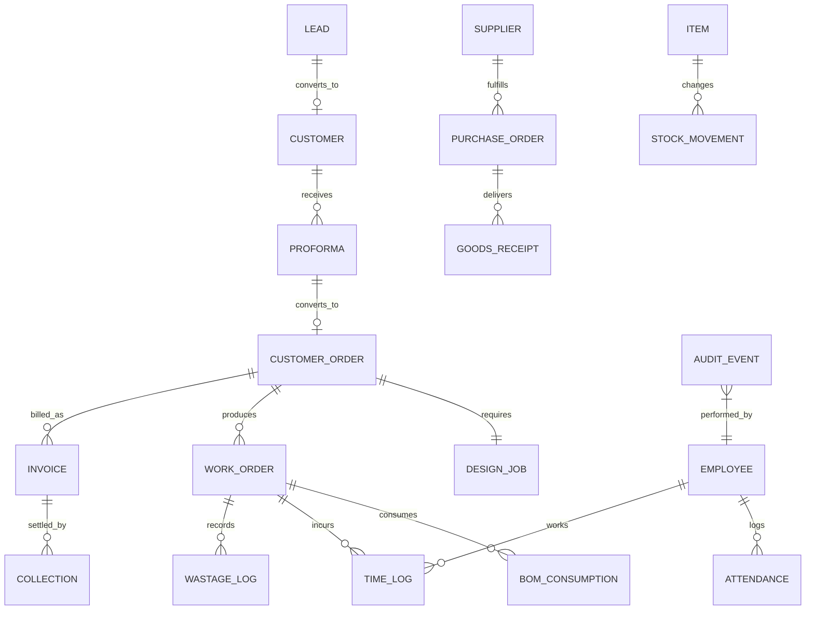

# Dot Advert ERP — Refined 8-Module Implementation Plan

An enterprise-grade, fully interactive, frontend-only mockup for **Dot Advert ERP** built using **Next.js (App Router)** and **TypeScript**, backed by realistic pre-seeded Ethiopian advertising & manufacturing demo data and reactive `localStorage` persistence.

---

## 1. Executive Summary & Architectural Shift

The system is structured around **8 distinct operational modules** tailored specifically for advertising, large format printing, and custom signage manufacturing in Ethiopia (ETB currency, 15% VAT / Non-VAT dual compliance, Telebirr/CBE/Chapa collections, and statutory pension/overtime rules):

```
┌───────────────────────────────────────────────────────────────────────────────┐
│                      DOT ADVERT ERP — 8 CORE MODULES                          │
├───────────────────────────────────────────────────────────────────────────────┤
│ 1. CRM          : Lead Management, Customer Accounts, Site Measurements       │
│ 2. Order        : Customer Orders, Graphic Design Proofing, Production BOM    │
│ 3. Sales        : Proforma Invoices, Tax Invoices (15% VAT/Exempt), Receipts  │
│ 4. HR           : Employee Roster, Daily Attendance, Overtime, Payroll        │
│ 5. Inventory    : Stores & Warehouses, Purchasing (PO/GRN), Transfers, Scrap  │
│ 6. Finance      : Income & Cash Flow, Operating Expenses, Net Margin, VAT     │
│ 7. Report       : Comparisons, Visual Analytics, Export, Audit Log (Who/When) │
│ 8. Dashboard    : Executive Cockpit & Unified Multi-Module Summary            │
├───────────────────────────────────────────────────────────────────────────────┤
│ ★ MODULES & FORMS DIRECTORY (/modules): Universal Interactive Card Hub        │
└───────────────────────────────────────────────────────────────────────────────┘
```

---

## 2. Detailed Module Specifications

### Module 1: CRM (Lead & Customer Management)
- **Leads Pipeline**:
  - Lead sources (Walk-in, Referral, Tender, Social Media, Phone Inquiry).
  - Pipeline stages: `New Lead` $\rightarrow$ `Site Survey / Measurement Needed` $\rightarrow$ `Quoted` $\rightarrow$ `Negotiation` $\rightarrow$ `Won` / `Lost`.
  - Estimated budget, required delivery timeline, and client contact person.
- **Customer Directory**:
  - Company legal name, trade name, TIN number, VAT registration status.
  - Credit limit, payment terms (Cash on Delivery, 15 Days, 30 Days), outstanding balance, and available credit safety check.
- **Key Forms & Views**:
  - `New Lead Modal`: Capture customer inquiry, dimensions, specs, and budget.
  - `Customer Profile Card`: Contact details, ledger summary, lifetime order value.

---

### Module 2: Order (Customer Order, Design Proofing & Production)
- **Customer Order**:
  - Converted from won lead or approved Proforma.
  - Delivery deadline, contracted amount (ETB), deposit received, project manager.
- **Graphic Design & Proofing (Advertising Specific)**:
  - Design status: `Drafting` $\rightarrow$ `Client Proofing` $\rightarrow$ `Revision Requested` $\rightarrow$ `Approved for Print/Fab`.
  - Design file specs: Dimensions ($W \times H$ in meters/cm), material type, resolution, color profile (CMYK), mockup preview link.
- **Production & Bill of Materials (BOM)**:
  - Work Order tracking: `Queued` $\rightarrow$ `In Production` $\rightarrow$ `Quality Inspection` $\rightarrow$ `Completed` $\rightarrow$ `Delivered / Installed`.
  - BOM item allocation: Direct materials consumed from inventory (vinyl, acrylic sheets, LED modules, metal framing).
  - Machine routing: Large format printer, CNC router, laser cutter, welding, signage assembly.
  - Machine hours and scrap/wastage tracking tagged to job ID.
- **Key Forms & Views**:
  - `Create Order Form`: Select customer, set deadline, attach initial specs.
  - `Design Review Panel`: Upload mockup link, mark client approval, sign off dimensions.
  - `Work Order & BOM Simulator`: Add material lines, log machine hours, record scrap.

---

### Module 3: Sales (Proforma, Tax Invoices & Collections)
- **Proforma Invoices (Ethiopian Commercial Standard)**:
  - Official quote document with validity period (e.g., 15 or 30 days).
  - Itemized pricing, unit of measure, 15% VAT calculation or statutory tax exemption justification.
  - One-click **"Convert Proforma to Customer Order & Tax Invoice"**.
- **Commercial & Tax Invoicing**:
  - Dual Mode:
    - **15% VAT Invoice**: Subtotal + 15% VAT + Total, with seller and buyer TIN, printable invoice template, and QR code verification mock.
    - **Non-VAT / Exempt Invoice**: Statutory exemption reason recorded (e.g. medical, educational, export, or under VAT threshold).
- **Collections & Payment Receipts**:
  - Payment methods: **Telebirr**, **CBE Bank Transfer**, **Awash Bank**, **Chapa**, **Cash**, and **Cheque**.
  - Reconciles invoice payment status (`Unpaid`, `Partially Paid`, `Paid`) and instantly restores customer credit balance.
- **Key Forms & Views**:
  - `Generate Proforma Form`: Add items, set discount, pick VAT type.
  - `Tax Invoice Printable View`: Clean printable preview with Ethiopian business header.
  - `Record Payment Modal`: Select payment channel, transaction reference ID, and amount paid.

---

### Module 4: HR (Employee, Attendance, Overtime & Payroll)
- **Employee Master**:
  - Personal info, national ID/Kebele ID, position/department (Graphic Design, Machine Operator, Fabrication, Installation, Sales, Finance).
  - Base salary / hourly wage, bank account details.
- **Attendance & Overtime Tracking**:
  - Daily clock-in/out status (Present, Absent, On Leave, Late).
  - Overtime hours logging (Regular Overtime 1.25x, Weekend/Night 1.5x, Public Holiday 2.0x).
  - **Direct Labor Allocation**: Operator hours logged here are directly allocated to specific customer work orders to calculate real job cost.
- **Monthly Payroll Engine**:
  - Gross salary = Base + Overtime + Allowances.
  - Deductions: Ethiopian income tax brackets, Employee Pension (7%), Advances.
  - Employer Pension (11%) contribution calculation.
- **Key Forms & Views**:
  - `Employee Registration Form`: Role, hourly rate, department.
  - `Log Attendance & Overtime Modal`: Select worker, log hours, tag Work Order ID.
  - `Monthly Payroll Run`: Automated payslip calculation and summary sheet.

---

### Module 5: Inventory (Store, Purchase, Store Transfer & Wastage)
- **Stores & Warehouses**:
  - Multi-warehouse separation: Main Warehouse, Raw Materials Store, Production Floor, Finished Goods Store.
  - Stock levels with unit of measure (meters, sheets, kg, pcs, rolls).
  - Automated Low-Stock warning rule:
    $$\text{Days Remaining} = \frac{\text{Current Stock}}{\text{Average Daily Usage}}$$
- **Purchase & Procurement (PO $\rightarrow$ GRN)**:
  - Supplier directory with category (raw material, hardware, ink, equipment, transport).
  - Purchase Orders: Draft, Approved, Partially Received, Received, Cancelled.
  - Goods Receipt Note (GRN): Quality inspection, accepted vs rejected counts, batch/lot tracking.
- **Stock Movements & Store Transfers**:
  - Transfer materials between physical stores (e.g. Raw Material Store $\rightarrow$ Production Floor).
  - Direct issuance to customer job orders.
- **Wastage & Scrap Management**:
  - Reason logging: Damaged, Expired, Production Scrap, Off-cut loss, Measurement Error.
  - Wastage cost automatically added to order production cost.
- **Key Forms & Views**:
  - `Stock Movement / Transfer Modal`: Source store, destination store, item, qty.
  - `New Purchase Order Form`: Supplier selection, item lines, payment terms.
  - `Log Wastage Form`: Reason code, quantity, linked Work Order ID.

---

### Module 6: Finance (Income, Expense, Revenue, Profit & Margin)
- **Revenue & Invoiced Sales**:
  - Billed revenue (excluding VAT) vs collected cash flow.
  - Accounts Receivable (AR) aging brackets: Current, 1-30 days, 31-60 days, 61-90+ days.
- **Operating & Job-Linked Expenses**:
  - Categorization: Fixed (Rent, Electricity, Security), Variable (Delivery fuel, custom hardware), Semi-variable.
  - Order-linking: Tagging specific expenses directly to a customer work order.
- **Job Profitability Engine (Real-Time Waterfall)**:
  $$\text{Total Job Cost} = \text{Direct Materials} + \text{Direct Labor} + \text{Machine Cost} + \text{Wastage} + \text{Allocated Overhead}$$
  $$\text{Net Margin \%} = \frac{\text{Net Invoiced Revenue} - \text{Total Job Cost}}{\text{Net Invoiced Revenue}} \times 100$$
- **VAT Ledger (ERCA Tax Compliance)**:
  - Output VAT collected from customer invoices.
  - Input VAT paid on supplier purchase receipts.
  - Net VAT Payable calculation.
- **Key Forms & Views**:
  - `Record Expense Form`: Category, Fixed vs Variable, Optional Order ID tag.
  - `P&L Financial Statement`: Real-time Income Statement breakdown.

---

### Module 7: Report (Comparison, Charts, Export, Audit Log "Who, What, When")
- **Comparative Analytics**:
  - Month-over-month revenue vs target.
  - Quoted estimated cost vs actual production cost variance.
  - Scrap rate by machine and operator.
- **Visual Charts & Graphs**:
  - Revenue trends, order status breakdown, inventory valuation per warehouse.
- **Export Center**:
  - One-click export to CSV / Excel and printable PDF financial summaries.
- **Audit Trail & Activity Log ("Who, What and When")**:
  - Immutable activity history recording:
    - *Timestamp* (When)
    - *User / Staff* (Who)
    - *Action Type* (What: Created PO, Approved Design, Issued Stock, Recorded Payment)
    - *Module & Entity Reference* (Which Document)
    - *Details & Value Impact*
- **Key Forms & Views**:
  - `Audit Log Viewer`: Filterable by date, staff, module, and action type.
  - `Export Hub`: Formats for accounting and management review.

---

### Module 8: Dashboard (Unified Multi-Module Summary)
- High-level executive overview consolidating:
  - 4 Key Metrics: Total Revenue, Direct Cost of Goods Sold, Gross Profit, Net Profit Margin %.
  - Live Operational Widgets: Active Work Orders, Due Invoices, Low Stock Alerts, Today's Collections.
  - Quick action shortcuts to primary forms in each module.

---

## 3. The Central Module & Cards Directory (`/modules`)

To address the requirement for a unified, comprehensive card-based index page where users can browse, search, and launch all modules and forms from a single location:

### Features of the Card Directory:
1. **Interactive Search & Category Filters**:
   - Filter cards instantly by category (`All`, `CRM`, `Order`, `Sales`, `HR`, `Inventory`, `Finance`, `Report`, `Dashboard`).
   - Real-time text search across all module titles, features, and form actions.
2. **Comprehensive Card Layout for Each Operational Unit**:
   - Visual icon and color-coded status badge.
   - Module name, sub-category, and detailed description of the workflows supported.
   - Primary direct navigation link to the main screen.
   - Secondary quick-action links directly to key forms (e.g. *+ New Lead*, *+ Create Proforma*, *+ Log Stock Movement*, *+ Record Expense*).
   - Live badge indicators showing real data state (e.g. *3 Active Leads*, *2 Overdue Invoices*, *3 Low Stock*).
3. **Accessibility**:
   - Accessible via `/modules` and `/forms`.
   - Prominently pinned in the navigation sidebar and top header bar.

---

## 4. Mock Data Architecture & Entity Relationship



---

## 5. Implementation Roadmap & Milestones

### Phase 1: Planning, Schema & Card Directory (Current Milestone)
- [x] Align on 8 core modules matching real-world advertising manufacturing.
- [x] Update `IMPLEMENTATION_PLAN.md` with complete module definitions.
- [x] Build the **Unified Module & Cards Directory** at `/modules` with search, category filtering, live badges, and direct links.
- [x] Update `Sidebar.tsx` and `Header.tsx` to expose the Module Hub.

### Phase 2: CRM & Sales Proforma Pipeline
- [ ] Add `Lead` and `Proforma` types to `src/types/erp.ts`.
- [ ] Add mock leads and proformas in `src/data/initialMockData.ts`.
- [ ] Build `/crm` page with Lead Kanban / List and "Convert to Customer & Proforma".
- [ ] Enhance `/sales` to support Proforma generation, PDF preview, and conversion to Tax Invoice.

### Phase 3: Order Engine — Design Proofing & Production
- [x] Add Design stages (`Drafting`, `Client Proofing`, `Revision Requested`, `Approved`) in `/orders`.
- [x] Add visual mockup viewer, technical fabrication parameters, and client revision audit trail.
- [x] Multi-Item Work Order BOM engine with machine routing, QC sign-off, runtime hour logging, and scrap/wastage tracking.

### Phase 4: HR Attendance, Overtime & Labor Allocation
- [ ] Enhance `/payroll` with dedicated Attendance & Overtime tabs.
- [ ] Enable direct linking of overtime hours to specific customer work order numbers.

### Phase 5: Inventory Transfers & Purchasing
- [ ] Enhance `/inventory` with a dedicated "Store Transfers" tab.
- [ ] Integrate Purchasing and Supplier POs into seamless store receipts.

### Phase 6: Finance & Audit Trail Reports
- [ ] Add the "Who, What, When" **Audit Trail & Activity Log** component in `/reports`.
- [ ] Add printable/exportable report summaries (CSV/Print views).
- [ ] Refresh Executive Dashboard KPIs with the unified 8-module summary.

---

## 6. Verification & Acceptance Criteria
- [x] Complete alignment between `IMPLEMENTATION_PLAN.md` and user-approved 8-module architecture.
- [x] A single, comprehensive **Module & Cards Directory** page (`/modules` & `/forms`) linking to all 8 modules and 24+ operational forms.
- [x] High visual quality adhering to design tokens (dark aesthetic, vibrant category accents, micro-animations, glassmorphism cards).
- [x] TypeScript builds cleanly with zero errors.
